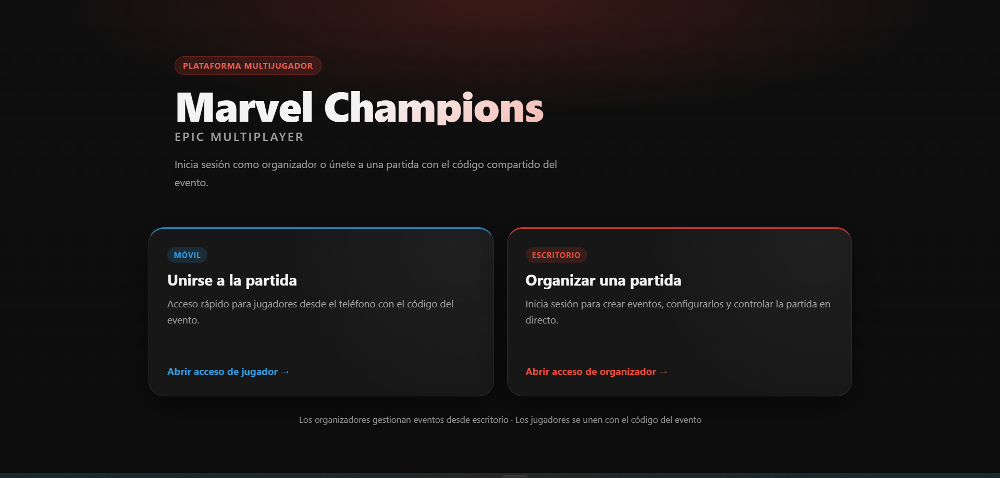
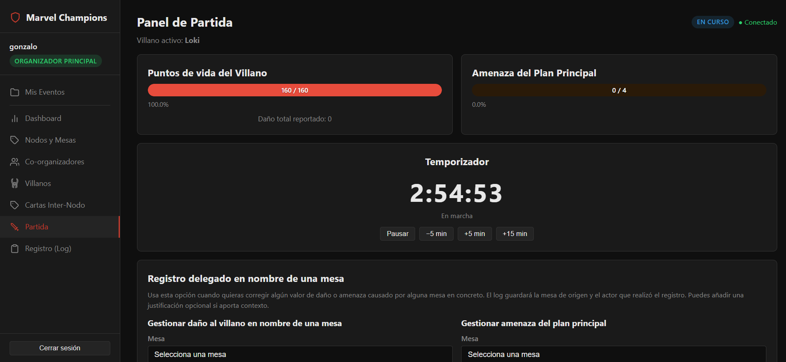
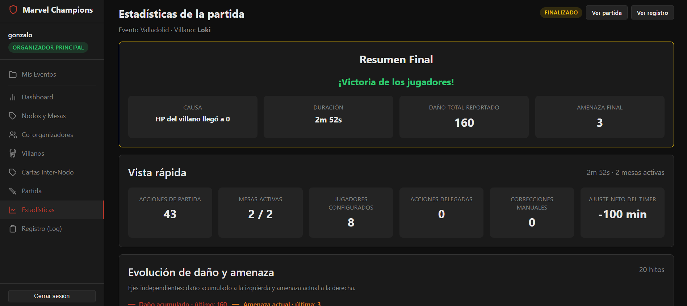
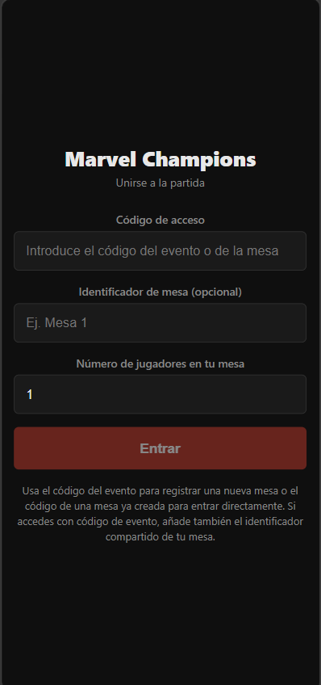
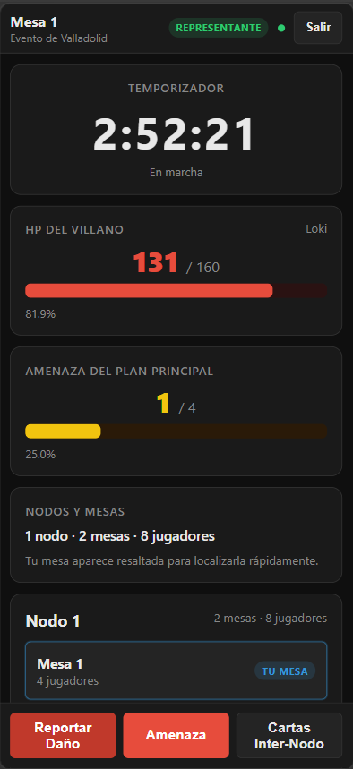
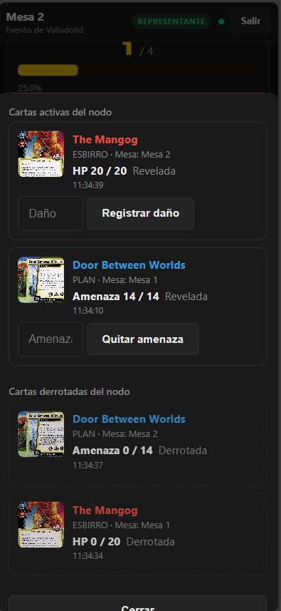

# Gestión de eventos multijugador de Marvel Champions

## Resumen del proyecto

Esta aplicación web permite organizar partidas presenciales del modo **Multijugador épico** de *Marvel Champions*. El juego continúa desarrollándose de forma física en cada mesa, mientras la plataforma coordina los elementos compartidos del evento: la vida del villano, la amenaza del plan principal, el temporizador, la distribución de mesas en nodos y las cartas inter-nodo.

El sistema conecta en tiempo real al equipo organizador con los representantes de las mesas. Los organizadores preparan y supervisan la partida desde una interfaz de escritorio, mientras los jugadores utilizan una interfaz móvil para consultar el estado global y comunicar el progreso de su mesa.

El proyecto se ha desarrollado como Trabajo de Fin de Grado del Grado en Ingeniería Informática de la Universidad de Valladolid.

## Capturas

<p align="center">
  
</p>

**Organizador (escritorio):** panel de partida en directo y estadísticas al terminar.

| Panel de partida | Estadísticas finales |
| --- | --- |
|  |  |

**Representante de mesa (móvil):** unirse con el código del evento, seguir el estado global y reportar el progreso de la mesa.

<p align="center">
  
  &nbsp;
  
  &nbsp;
  
</p>

## Resultados de las pruebas de carga

Medido con el [arnés de carga](load-tests/README.md) (clientes sintéticos con login HTTP y WebSocket/STOMP), con 100 clientes conectados a la vez durante 30 s de carga estable:

| Escenario | Operaciones | Entregas en tiempo real | Errores | HTTP p95 | Propagación a todos los clientes p95 |
| --- | ---: | ---: | ---: | ---: | ---: |
| 100 clientes, 20 escritores/s | 600 | 60 100 | 0 | 14 ms | 8 ms |
| 100 clientes, 100 escritores/s | 3 000 | 300 300 | 0 | 29 ms | 12 ms |

El requisito no funcional de latencia (p95 HTTP < 500 ms) se cumple con margen. Las pruebas se hicieron en local, sin latencia de red; en un despliegue real los valores serán algo mayores.

## Manuales

- [Manual de instalación y despliegue](docs/manual-instalacion.md)
- [Manual de usuario](docs/manual-usuario.md)

El manual de instalación explica los requisitos, la configuración y las distintas formas de ejecutar la aplicación. El manual de usuario describe el flujo completo de organizadores y jugadores.

## Cómo funciona el proyecto

### Organización de una partida

El organizador crea un evento, selecciona el villano y las cartas inter-nodo disponibles, y comparte un código de acceso con los jugadores. Los representantes utilizan ese código para registrar sus mesas. Antes de comenzar, el organizador distribuye las mesas entre los distintos nodos y puede delegar la supervisión de la vida del villano, la amenaza o el temporizador en otros usuarios.

Durante la partida, las mesas comunican el daño infligido, la amenaza generada y la aparición o resolución de cartas inter-nodo. Todos estos cambios actualizan un estado global compartido. El organizador puede seguir la evolución del evento, ajustar el temporizador y corregir acciones erróneas sin perder el historial.

Al finalizar la partida, la aplicación genera un resumen y estadísticas a partir del registro de acciones.

### Interfaces de usuario

El frontend está formado por tres aplicaciones Vue:

- **Portal:** página de entrada desde la que se elige entre organizar una partida o unirse a ella.
- **Organizador:** interfaz orientada a escritorio para configurar eventos, administrar catálogos, distribuir mesas, gestionar coorganizadores y supervisar la partida.
- **Jugador:** interfaz adaptada a dispositivos móviles para unirse mediante un código, consultar el estado compartido y registrar las acciones de la mesa.

Las tres aplicaciones se publican bajo una misma dirección. Esta separación permite adaptar la navegación y los controles a las necesidades de cada perfil sin duplicar la lógica compartida.

### Backend y comunicación

El backend está desarrollado con Java 17 y Spring Boot. Expone una **API REST** para las operaciones de autenticación, configuración y gestión del estado, y utiliza **WebSockets** para enviar las actualizaciones de la partida en tiempo real.

La API REST se utiliza para acciones como crear eventos, registrar mesas, configurar nodos o enviar daño y amenaza. Tras procesar un cambio, el backend publica el nuevo estado mediante WebSocket para que las interfaces conectadas se actualicen sin necesidad de recargar la página.

La autenticación de organizadores, coorganizadores y mesas se basa en tokens JWT. Los datos se almacenan en una base H2 en fichero, tanto en desarrollo local como dentro de un volumen cuando se ejecuta con Docker.

### Arquitectura

| Componente | Tecnología | Responsabilidad |
| --- | --- | --- |
| Backend | Java 17 y Spring Boot | API REST, autenticación, reglas de negocio y comunicación en tiempo real |
| Frontend | Vue 3 y Vite | Portal, aplicación de organizador y aplicación móvil de jugador |
| Tiempo real | WebSocket, STOMP y SockJS | Sincronización del estado entre organizadores y mesas |
| Persistencia | H2 en fichero | Eventos, usuarios, configuración y registro de acciones |
| Despliegue | Docker Compose y Nginx | Construcción, publicación y persistencia mediante volumen |

En desarrollo, el frontend unificado se publica en `http://localhost:5175` y redirige las peticiones de API y WebSocket al backend, disponible en `http://localhost:8080`.

## Estructura del repositorio

```text
backend/            API REST, seguridad, reglas de negocio y WebSocket
frontend/           Portal y aplicaciones de organizador y jugador
docs/               Manuales y diagramas del sistema
load-tests/         Escenarios y herramientas de pruebas de carga
docker-compose.yml  Despliegue con contenedores
start-dev.ps1       Arranque del entorno de desarrollo
reset-db.ps1        Reinicio de la base de datos local
```

## Documentación técnica

- [Pruebas de carga](load-tests/README.md)
- [Diagrama de arquitectura lógica](docs/diagrama-arquitectura-sistema.puml)
- [Diagrama del modelo de dominio](docs/diagrama-modelo-dominio.puml)
- [Diagrama entidad-relación](docs/diagrama-entidad-relacion.puml)

## Contexto académico

- **Autor:** Gonzalo José Colina Báscones
- **Tutor:** Mario Corrales Astorgano
- **Licencia:** [MIT](LICENSE)

## Aviso

*Marvel Champions: The Card Game* y sus elementos relacionados pertenecen a Fantasy Flight Games y a sus respectivos titulares. Este proyecto es una herramienta académica no oficial y no está afiliado con ellos.